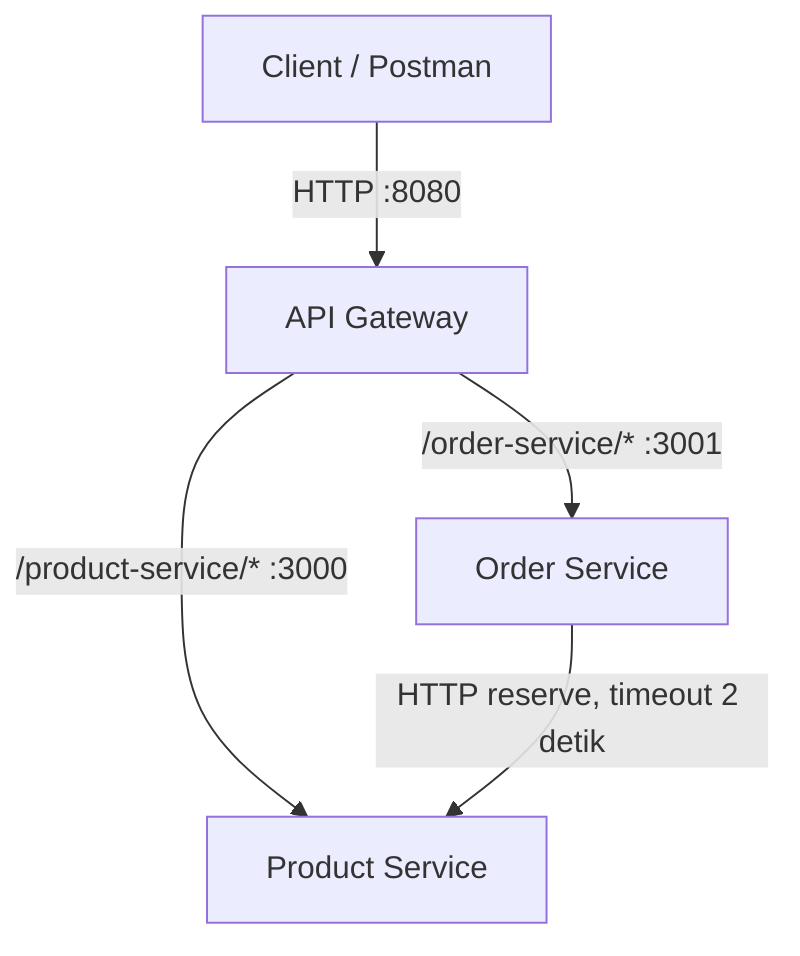

# Praktikum Web Service Sesi 09

## Arsitektur



Gateway menghapus prefix service saat meneruskan path. Contohnya,
`/product-service/products` diteruskan ke `Product Service` sebagai
`/products`, sedangkan `/order-service/orders` diteruskan sebagai `/orders`.
Gateway mempertahankan rate limit Lab 08 (20 request per 10 detik).

## Kepemilikan data dan API

| Service | Data yang dimiliki | API yang ditawarkan | Contoh pemanggilan antar-service |
|---|---|---|---|
| Product Service | Katalog produk dan stok; data saat ini disimpan di memori service | `GET /products`, `GET /products/:id`, `POST /products/:id/reserve` | Order Service meminta `POST http://localhost:3000/products/:id/reserve` dengan `{ "qty": 2 }` |
| Order Service | Riwayat pesanan dan snapshot nama/harga ketika order dibuat; data saat ini disimpan di memori service | `POST /orders`, `GET /orders` | Saat `POST /orders`, Order Service meminta reservasi ke Product Service sebelum menyimpan order |

## Rancangan untuk proyek individu: FASILITASE AREK

Tabel berikut adalah rancangan berdasarkan deskripsi proyek yang diberikan,
bukan klaim bahwa service-service ini sudah ada di source code proyek
individu. Data pembayaran tidak dimasukkan karena implementasi pembayarannya
belum dikonfirmasi.

| Service | Data yang dimiliki | API yang ditawarkan | Contoh pemanggilan dari service lain |
|---|---|---|---|
| Identity/User Service | Akun dan identitas pengguna; kredensial tidak dibagikan ke service lain | `POST /auth/register`, `POST /auth/login`, `GET /users/:id` | Booking Service meminta `GET /users/:id` untuk memvalidasi pengguna sebelum menerima booking |
| Facility Service | Data Facility, Category, dan Room (nama, deskripsi, lokasi, kapasitas, status); tidak memiliki jadwal booking | `GET /facilities`, `GET /facilities/:id`, `GET /facilities/:id/rooms/:roomId` | Booking Service meminta detail room untuk memeriksa facility/room dan statusnya sebelum booking |
| Booking Service | Booking, tanggal/jadwal, user/facility/room ID sebagai referensi, dan status; bertanggung jawab atas ketersediaan slot serta pencegahan pemesanan ganda | `POST /bookings`, `GET /bookings`, `GET /bookings/availability?roomId=...&date=...`, `PATCH /bookings/:id/status` | Admin service/backend meminta `GET /bookings` atau `PATCH /bookings/:id/status` untuk mengelola pesanan |

Panggilan admin pada baris terakhir mengasumsikan operasi admin ditempatkan
di service/backend terpisah; deskripsi proyek mengonfirmasi fitur admin,
tetapi tidak menjelaskan apakah backend admin terpisah dari client/gateway.
Jika tidak ada service admin terpisah, gateway atau backend-for-frontend dapat
memanggil API Booking Service secara langsung. Registrasi/login dan data user
dipisahkan dari data booking. Integrasi Payment Service tidak dirancang sampai
keberadaan fitur pembayaran terkonfirmasi.

Untuk ketersediaan, Booking Service menjadi sumber kebenaran atas slot dan
reservasi. Detail fasilitas/ruangan tetap dimiliki Facility Service; Booking
Service memanggilnya untuk validasi, bukan menyalin seluruh katalog. Contoh
API Booking Service di atas dapat dipanggil client/admin backend untuk membaca
ketersediaan. Bila Facility Service juga perlu menampilkan ketersediaan dengan
memanggil Booking Service, hindari membuat pemanggilan sinkron dua arah antara
Facility dan Booking; gunakan komposisi di gateway/backend-for-frontend atau
buat read model ketersediaan yang dirancang khusus.

## Menjalankan aplikasi

Jalankan masing-masing perintah di terminal terpisah dari root proyek:

```powershell
node .\gateway\gateway.js
node .\product-service\index.js
node .\order-service\index.js
```

Node.js 18 atau lebih baru diperlukan. Buat order lewat gateway dengan:

```powershell
Invoke-RestMethod -Uri http://localhost:8080/order-service/orders `
  -Method Post -ContentType 'application/json' `
  -Body '{"productId":1,"qty":2}'
```

Order Service dapat dikonfigurasi untuk memakai URL Product Service lain melalui
environment variable `PRODUCT_SERVICE_URL`. Data produk dan pesanan disimpan
di memori; masing-masing akan kembali ke keadaan awal ketika servicenya dimulai
kembali.

## Pengujian

Dengan ketiga proses berjalan dan data produk masih pada keadaan awal, jalankan:

```powershell
node .\smoke-test.js
```

Smoke test memeriksa tiga produk, order `productId: 1` dengan `qty: 2` berstatus
HTTP 201, dan stok produk pertama turun dari 10 menjadi 8. Test mengharapkan
keadaan awal, jadi jalankan ulang service Product sebelum mengulang smoke test.

Untuk menguji kegagalan Product Service:

1. Hentikan proses Product Service.
2. Kirim `POST /order-service/orders` melalui gateway; respons yang diharapkan
   adalah HTTP 503.
3. Kirim `GET /order-service/orders`; riwayat tetap diharapkan berstatus HTTP
   200 selama Order Service dan gateway berjalan.
4. Nyalakan kembali Product Service dan buat order dengan stok cukup; respons
   yang diharapkan adalah HTTP 201.

Respons proxy gateway ketika service tujuan langsung tidak tersedia adalah HTTP
502. Timeout request Order Service ke Product Service menggunakan
`AbortSignal.timeout(2000)`.

### Hasil uji yang benar-benar dijalankan

- Smoke test: HTTP 200 untuk daftar tiga produk, HTTP 201 untuk order, stok
  produk pertama menjadi 8.
- Product Service dihentikan: pembuatan order mengembalikan HTTP 503 dan
  pembacaan riwayat order mengembalikan HTTP 200.
- Product Service dinyalakan kembali: order baru mengembalikan HTTP 201.
- Produk tidak ditemukan: HTTP 404; stok tidak cukup: HTTP 409; kuantitas tidak
  valid: HTTP 400.
- Uji timeout memakai service mock yang menunda respons 3 detik; Order Service
  mengembalikan HTTP 503 setelah sekitar 2,3 detik.

Screenshot keluaran terminal tidak dibuat otomatis oleh smoke test. Ambil
screenshot setelah menjalankan pengujian agar bukti mencerminkan keluaran
aktual.

## Refleksi

Order Service tetap dapat menampilkan riwayat pesanan ketika Product Service
mati karena riwayat dimiliki dan disimpan oleh Order Service. Pembuatan order
baru tetap memerlukan reservasi stok, sehingga gagal dengan HTTP 503 ketika
Product Service tidak tersedia atau request-nya timeout. Jika stok berhasil
dikurangi tetapi Order Service gagal menyimpan pesanan setelahnya, stok dan
riwayat dapat tidak konsisten karena implementasi ini belum memiliki transaksi
lintas-service atau mekanisme pemulihan. Dibandingkan monolit, microservices
memisahkan tanggung jawab dan mengisolasi sebagian kegagalan, tetapi menambah
kompleksitas komunikasi jaringan, konfigurasi, dan konsistensi data.
