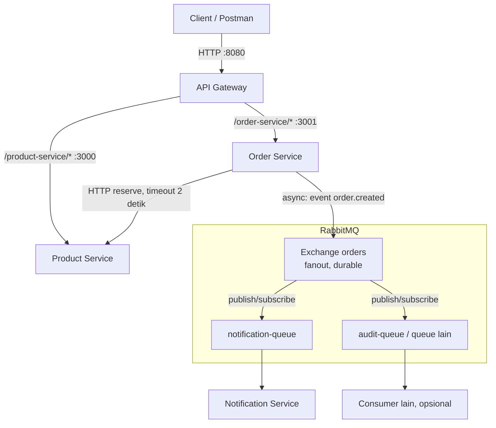

# Praktikum Web Service Lab 09–10

## Perubahan Week 09 ke Week 10

Implementasi Week 09 tetap dipertahankan: API Gateway pada port 8080, Product
Service pada port 3000, Order Service pada port 3001, rate limit 20 request per
10 detik, dan reservasi stok melalui HTTP dengan timeout 2 detik. Week 10
menambahkan RabbitMQ untuk menerbitkan event `order.created` dari Order Service
ke Notification Service. Reservasi stok tidak dipindahkan ke RabbitMQ.

## Arsitektur sistem



Gateway menghapus prefix service saat meneruskan path. Contohnya,
`/product-service/products` diteruskan ke `Product Service` sebagai
`/products`, sedangkan `/order-service/orders` diteruskan sebagai `/orders`.
Gateway mempertahankan rate limit 20 request per 10 detik. RabbitMQ hanya
digunakan oleh Order Service sebagai producer dan Notification Service sebagai
consumer; Gateway tidak terhubung ke RabbitMQ.

Exchange `orders` bertipe `fanout`, sehingga setiap queue yang sudah terikat
menerima salinan event. Consumer dengan queue bernama sama berbagi pesan sebagai
competing consumers; queue yang berbeda masing-masing menerima salinan sebagai
pub/sub.

## Kepemilikan data dan API

| Service | Data yang dimiliki | API yang ditawarkan | Contoh pemanggilan antar-service |
|---|---|---|---|
| Product Service | Katalog produk dan stok; data saat ini disimpan di memori service | `GET /products`, `GET /products/:id`, `POST /products/:id/reserve` | Order Service meminta `POST http://localhost:3000/products/:id/reserve` dengan `{ "qty": 2 }` |
| Order Service | Riwayat pesanan dan snapshot nama/harga ketika order dibuat; data saat ini disimpan di memori service | `POST /orders`, `GET /orders` | Saat `POST /orders`, Order Service meminta reservasi ke Product Service sebelum menyimpan order |

## Rancangan untuk proyek individu: FASILITASE AREK

Tabel berikut adalah rancangan berdasarkan deskripsi proyek yang diberikan,
bukan klaim bahwa service-service ini sudah ada di source code proyek
individu. Data pembayaran tidak dimasukkan karena implementasi pembayarannya
belum dikonfirmasi.

| Service | Data yang dimiliki | API yang ditawarkan | Contoh pemanggilan dari service lain |
|---|---|---|---|
| Identity/User Service | Akun dan identitas pengguna; kredensial tidak dibagikan ke service lain | `POST /auth/register`, `POST /auth/login`, `GET /users/:id` | Booking Service meminta `GET /users/:id` untuk memvalidasi pengguna sebelum menerima booking |
| Facility Service | Data Facility, Category, dan Room (nama, deskripsi, lokasi, kapasitas, status); tidak memiliki jadwal booking | `GET /facilities`, `GET /facilities/:id`, `GET /facilities/:id/rooms/:roomId` | Booking Service meminta detail room untuk memeriksa facility/room dan statusnya sebelum booking |
| Booking Service | Booking, tanggal/jadwal, user/facility/room ID sebagai referensi, dan status; bertanggung jawab atas ketersediaan slot serta pencegahan pemesanan ganda | `POST /bookings`, `GET /bookings`, `GET /bookings/availability?roomId=...&date=...`, `PATCH /bookings/:id/status` | Admin service/backend meminta `GET /bookings` atau `PATCH /bookings/:id/status` untuk mengelola pesanan |

Panggilan admin pada baris terakhir mengasumsikan operasi admin ditempatkan
di service/backend terpisah; deskripsi proyek mengonfirmasi fitur admin,
tetapi tidak menjelaskan apakah backend admin terpisah dari client/gateway.
Jika tidak ada service admin terpisah, gateway atau backend-for-frontend dapat
memanggil API Booking Service secara langsung. Registrasi/login dan data user
dipisahkan dari data booking. Integrasi Payment Service tidak dirancang sampai
keberadaan fitur pembayaran terkonfirmasi.

Untuk ketersediaan, Booking Service menjadi sumber kebenaran atas slot dan
reservasi. Detail fasilitas/ruangan tetap dimiliki Facility Service; Booking
Service memanggilnya untuk validasi, bukan menyalin seluruh katalog. Contoh
API Booking Service di atas dapat dipanggil client/admin backend untuk membaca
ketersediaan. Bila Facility Service juga perlu menampilkan ketersediaan dengan
memanggil Booking Service, hindari membuat pemanggilan sinkron dua arah antara
Facility dan Booking; gunakan komposisi di gateway/backend-for-frontend atau
buat read model ketersediaan yang dirancang khusus.

## Instalasi dependency

Jalankan dari root proyek di PowerShell:

```powershell
npm install --prefix .\gateway
npm install --prefix .\product-service
npm install --prefix .\order-service
npm install --prefix .\notification-service
```

Node.js 18 atau lebih baru diperlukan. RabbitMQ menggunakan image Docker
`rabbitmq:3-management`, AMQP pada port 5672, dashboard pada port 15672, dan
kredensial lokal `guest` / `guest`.

## Menjalankan seluruh service

Mulai RabbitMQ terlebih dahulu:

```powershell
docker run -d --name lab10-rabbitmq -p 5672:5672 -p 15672:15672 rabbitmq:3-management
```

Jika container dengan nama tersebut sudah ada, mulai kembali dengan
`docker start lab10-rabbitmq`. Dashboard tersedia di
`http://localhost:15672`.

Jalankan setiap proses dalam terminal PowerShell terpisah dari root proyek,
urutannya:

```powershell
node .\product-service\index.js
node .\notification-service\notification-service.js
node .\order-service\index.js
node .\gateway\gateway.js
```

AMQP URL default adalah `amqp://localhost` dan dapat diubah lewat
`$env:AMQP_URL`. Order Service memulai koneksi RabbitMQ secara asynchronous dan
tetap melayani API saat RabbitMQ belum tersedia; upaya koneksi ulang dilakukan
setiap 3 detik. Notification Service menggunakan queue
`notification-queue` secara default. Nama queue dapat diberikan sebagai argumen.

Buat order lewat gateway:

```powershell
Invoke-RestMethod -Uri http://localhost:8080/order-service/orders `
  -Method Post -ContentType 'application/json' `
  -Body '{"productId":1,"qty":2}'
```

Order Service dapat dikonfigurasi untuk memakai URL Product Service lain melalui
environment variable `PRODUCT_SERVICE_URL`. Data produk dan pesanan disimpan
di memori; masing-masing akan kembali ke keadaan awal ketika servicenya dimulai
kembali. Saat berhasil, order dipublikasikan sebagai JSON dengan `messageId`
`order-<id>`, content type `application/json`, dan opsi persistent.

## Pengujian

### Week 09 smoke test

Dengan Product Service, Order Service, Gateway berjalan dan data produk masih
pada keadaan awal, jalankan:

```powershell
node .\smoke-test.js
```

Smoke test memeriksa tiga produk, order `productId: 1` dengan `qty: 2` berstatus
HTTP 201, dan stok produk pertama turun dari 10 menjadi 8. Test mengharapkan
keadaan awal, jadi mulai ulang Product Service sebelum mengulang smoke test.

### Consumer mati dan Ready = 3

Mulai semua service selain Notification Service, lalu buat tiga order yang
berhasil. Pastikan queue sudah dibuat terlebih dahulu: jalankan Notification
Service satu kali sampai log `mendengarkan queue` muncul, lalu hentikan dengan
Ctrl+C. RabbitMQ menghapus pesan fanout bila belum ada queue terikat saat
publikasi.

```powershell
1..3 | ForEach-Object {
  Invoke-RestMethod -Uri http://localhost:8080/order-service/orders `
    -Method Post -ContentType 'application/json' `
    -Body '{"productId":1,"qty":1}'
}
```

Buka `http://localhost:15672` dengan login `guest` / `guest`, lalu periksa
Queues and Streams. `notification-queue` diharapkan menunjukkan **Ready = 3**
sebelum consumer dinyalakan.

Jalankan consumer:

```powershell
node .\notification-service\notification-service.js
```

Hasil yang diharapkan: pesan diproses satu per satu (prefetch 1), log email
ditampilkan, pesan di-ACK, dan Ready kembali ke 0.

### Dua competing consumers

Jalankan perintah yang sama pada dua terminal bersamaan:

```powershell
node .\notification-service\notification-service.js
```

Kedua proses menggunakan queue `notification-queue` yang sama. Order baru
seharusnya dibagi kepada salah satu consumer pada tiap pesan, bukan diduplikasi
ke dua proses.

### Pub/Sub

Jalankan dua consumer, masing-masing di terminal sendiri:

```powershell
node .\notification-service\notification-service.js
node .\notification-service\notification-service.js audit-queue
```

Buat satu order. Hasil yang diharapkan: `notification-queue` dan `audit-queue`
masing-masing menerima salinan event dan mencetak log email. Queue bernama
`audit-queue` hanya mendemonstrasikan pub/sub; Audit Service terpisah tidak
ditambahkan.

### Crash dan redelivery

Pastikan queue `notification-queue` memiliki pesan baru yang belum diproses.
Jalankan:

```powershell
node .\notification-service\notification-service.js --crash
```

Hasil yang diharapkan: log email muncul, diikuti `crash sebelum ack!`, lalu
proses keluar dengan status 1 sebelum ACK. Setelah RabbitMQ mendeteksi koneksi
consumer tertutup, pesan belum-ACK dikembalikan ke queue. Jalankan consumer
normal lagi:

```powershell
node .\notification-service\notification-service.js
```

Pesan yang sama akan diproses ulang sehingga log email muncul kembali. Set
`processed` berada hanya di memori; proses baru tidak memiliki data deduplikasi
dari proses sebelumnya.

### Pengujian kegagalan Week 09

1. Hentikan Product Service.
2. Kirim `POST /order-service/orders` melalui gateway; respons yang diharapkan
   adalah HTTP 503.
3. Kirim `GET /order-service/orders`; riwayat tetap diharapkan berstatus HTTP
   200 selama Order Service dan gateway berjalan.
4. Nyalakan kembali Product Service dan buat order dengan stok cukup; respons
   yang diharapkan adalah HTTP 201.

Respons proxy gateway ketika service tujuan langsung tidak tersedia adalah HTTP
502. Timeout request Order Service ke Product Service menggunakan
`AbortSignal.timeout(2000)`.

### Hasil uji yang benar-benar dijalankan

Hasil berikut berasal dari pengujian Week 09 sebelumnya, bukan klaim bahwa
pengujian RabbitMQ Week 10 sudah dijalankan:

- Smoke test: HTTP 200 untuk daftar tiga produk, HTTP 201 untuk order, stok
  produk pertama menjadi 8.
- Product Service dihentikan: pembuatan order mengembalikan HTTP 503 dan
  pembacaan riwayat order mengembalikan HTTP 200.
- Product Service dinyalakan kembali: order baru mengembalikan HTTP 201.
- Produk tidak ditemukan: HTTP 404; stok tidak cukup: HTTP 409; kuantitas tidak
  valid: HTTP 400.
- Uji timeout memakai service mock yang menunda respons 3 detik; Order Service
  mengembalikan HTTP 503 setelah sekitar 2,3 detik.

Perubahan Week 10 perlu diverifikasi pada lingkungan dengan Docker dan RabbitMQ
aktif melalui langkah-langkah di atas. Smoke test tidak memvalidasi event
RabbitMQ. Screenshot keluaran terminal juga tidak dibuat otomatis.

## Keterbatasan dan konsistensi

- Jika RabbitMQ mati ketika order dibuat, pesanan tetap disimpan oleh Order
  Service dan HTTP 201 tetap diberikan. Jika channel tidak tersedia, event tidak
  terkirim dan implementasi ini tidak menyimpan event untuk dikirim ulang.
- Implementasi ini belum menggunakan Transactional Outbox; penyimpanan order dan
  publikasi event bukan satu transaksi atomik.
- Set `processed` hanya berada di memori, bukan idempotensi permanen. Deduplikasi
  hilang ketika proses consumer berhenti atau crash.
- Pengiriman setidaknya sekali dan crash setelah simulasi pengiriman email tetapi
  sebelum ACK dapat menyebabkan pemrosesan/pengiriman email berulang.
- Order dan stok tersimpan di memori service. Tidak ada transaksi lintas-service;
  jika stok terpotong tetapi penyimpanan order gagal, data dapat tidak konsisten.
