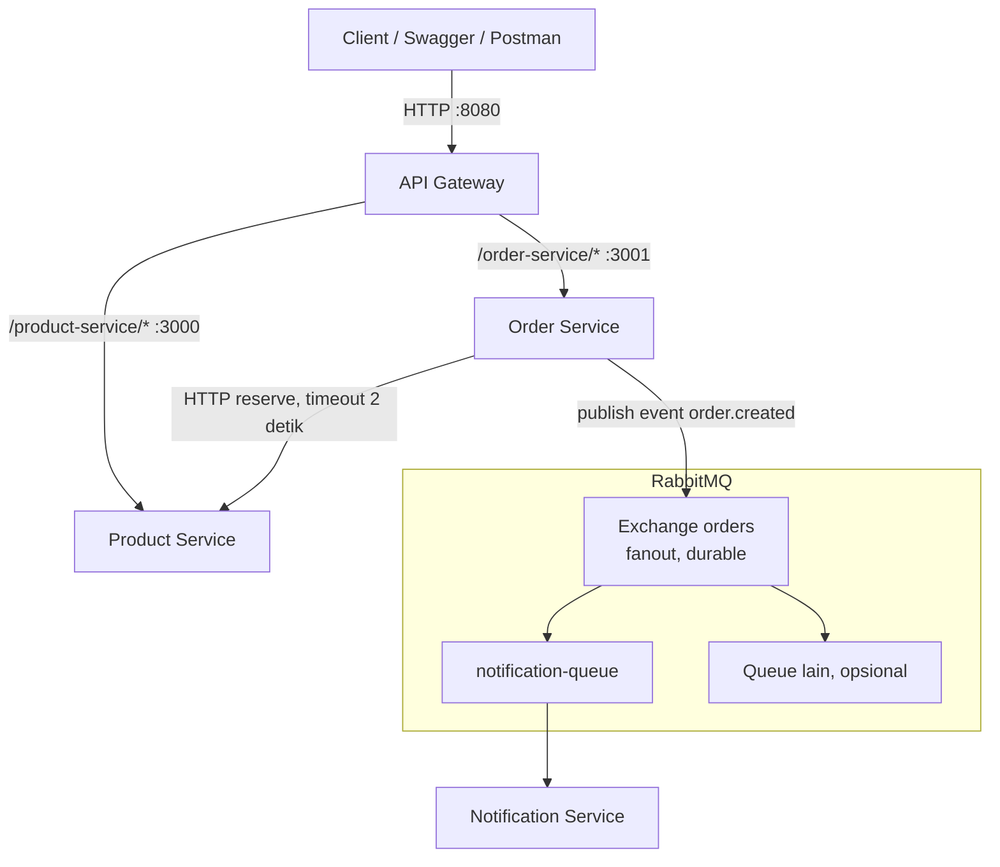

# Praktikum Web Service Lab 09–11

Repository ini berisi implementasi microservices toko sederhana untuk Lab 09 dan Lab 10, serta dokumentasi API menggunakan OpenAPI dan Swagger untuk Week 11.

## 1. Gambaran Sistem

Sistem terdiri dari empat komponen utama:

- **API Gateway**: pintu masuk HTTP untuk client, meneruskan request ke Product Service atau Order Service, dan menerapkan rate limiting.
- **Product Service**: mengelola katalog produk dan stok.
- **Order Service**: membuat dan membaca pesanan. Sebelum menyimpan pesanan, service ini meminta Product Service melakukan reservasi stok melalui HTTP.
- **Notification Service**: consumer RabbitMQ yang menerima event `order.created` dan mensimulasikan pengiriman notifikasi.

Data produk dan pesanan pada implementasi ini disimpan di memori proses, bukan database. Data akan kembali ke nilai awal ketika service terkait direstart.

## 2. Arsitektur Sistem



Gateway menghapus prefix service saat meneruskan request. Contohnya, `/product-service/products` diteruskan ke Product Service sebagai `/products`, sedangkan `/order-service/orders` diteruskan ke Order Service sebagai `/orders`.

Gateway menerapkan rate limit maksimum 20 request dalam 10 detik pada request API yang diteruskan melalui proxy. Gateway tidak terhubung langsung ke RabbitMQ.

RabbitMQ menggunakan exchange `orders` bertipe `fanout`. Setiap queue yang terikat pada exchange menerima salinan event. Beberapa consumer dengan nama queue yang sama berbagi pesan sebagai *competing consumers*; queue berbeda masing-masing menerima salinan sebagai pola *pub/sub*.

## 3. Port dan Endpoint Service

| Komponen | Port | Fungsi |
|---|---:|---|
| API Gateway | 8080 | Gateway, Swagger UI gabungan, dan OpenAPI gabungan |
| Product Service | 3000 | Katalog produk dan reservasi stok |
| Order Service | 3001 | Pembuatan dan pembacaan pesanan |
| RabbitMQ AMQP | 5672 | Komunikasi message broker |
| RabbitMQ Management | 15672 | Dashboard manajemen RabbitMQ |

### Product Service

| Method | Endpoint langsung | Fungsi |
|---|---|---|
| GET | `/products` | Mendapatkan seluruh produk |
| GET | `/products/:id` | Mendapatkan detail produk berdasarkan ID |
| POST | `/products/:id/reserve` | Melakukan reservasi stok produk |

### Order Service

| Method | Endpoint langsung | Fungsi |
|---|---|---|
| POST | `/orders` | Membuat pesanan baru |
| GET | `/orders` | Mendapatkan seluruh pesanan |

## 4. Dokumentasi API Week 11 — OpenAPI dan Swagger

Dokumentasi dibuat dengan pendekatan **code-first** menggunakan `swagger-jsdoc` dan `swagger-ui-express`. Anotasi Swagger JSDoc ditulis di dalam file sumber masing-masing service.

### URL dokumentasi

| Service | Swagger UI | OpenAPI JSON |
|---|---|---|
| Product Service | `http://localhost:3000/docs` | `http://localhost:3000/openapi.json` |
| Order Service | `http://localhost:3001/docs` | `http://localhost:3001/openapi.json` |
| API Gateway (gabungan) | `http://localhost:8080/docs` | `http://localhost:8080/openapi.json` |

Swagger UI pada API Gateway menggabungkan dokumentasi Product Service dan Order Service. Prefix endpoint pada dokumentasi gabungan adalah:

| Service | Endpoint pada Gateway |
|---|---|
| Product Service | `/product-service/products` |
| Product Service | `/product-service/products/{id}` |
| Product Service | `/product-service/products/{id}/reserve` |
| Order Service | `/order-service/orders` (POST dan GET) |

Nama schema diberi prefix agar tidak bertabrakan ketika dokumentasi beberapa service digabungkan, misalnya `ProductService_Product` dan `OrderService_Order`.

Gateway mengambil ulang spesifikasi dari kedua service saat endpoint `/openapi.json` diminta. Karena itu, Product Service dan Order Service harus aktif agar dokumentasi gabungan dapat dibentuk.

### Kode respons yang didokumentasikan

| Endpoint | Kode HTTP | Kondisi |
|---|---:|---|
| `GET /products` | 200 | Daftar produk berhasil diperoleh |
| `GET /products/{id}` | 200, 404 | Detail produk ditemukan atau ID produk tidak ditemukan |
| `POST /products/{id}/reserve` | 200, 400, 404, 409 | Reservasi berhasil, kuantitas tidak valid, produk tidak ditemukan, atau stok tidak cukup |
| `POST /orders` | 201, 400, 404, 409, 503 | Pesanan dibuat, input tidak valid, produk tidak ditemukan, stok tidak cukup, atau Product Service tidak tersedia/timeout |
| `GET /orders` | 200 | Daftar pesanan berhasil diperoleh |

Jika service tujuan tidak dapat dijangkau oleh Gateway, request yang diteruskan melalui proxy dapat memperoleh HTTP 502. Jika salah satu service tidak tersedia saat Gateway membangun spesifikasi gabungan, endpoint `/openapi.json` Gateway mengembalikan HTTP 503.

### Membuat file openapi.json

File `openapi.json` di root repository merupakan snapshot spesifikasi gabungan dari API Gateway. Perbarui file ini setiap kali kontrak API berubah:

```bash
curl -fsS http://localhost:8080/openapi.json -o openapi.json
```

Validasi file hasil ekspor:

```bash
node -e "
const spec = require('./openapi.json');
console.log('OpenAPI:', spec.openapi);
console.log('Nama API:', spec.info.title);
console.log('Jumlah path:', Object.keys(spec.paths).length);
console.log('Jumlah schemas:', Object.keys(spec.components.schemas).length);
"
```

Pada versi tugas ini, hasil yang diharapkan adalah OpenAPI `3.0.3`, judul `Toko Microservices API`, 4 path, dan 7 schemas.

### Simulasi Documentation Drift

Simulasi drift dilakukan dengan menambahkan properti `category` pada data produk tanpa memperbarui schema `Product` di Swagger. Akibatnya, response aktual API berisi `category`, sedangkan schema dokumentasi belum mencantumkannya.

Perbaikan dilakukan dengan menambahkan properti `category` ke schema `Product` dan memperbarui contoh response yang relevan. Setelah perbaikan, response API dan schema OpenAPI sama-sama memuat `category`.

Untuk mencegah drift dalam pengembangan tim, setiap perubahan endpoint atau model data harus disertai pembaruan anotasi OpenAPI, pemeriksaan melalui schema validation atau contract test, serta code review sebelum perubahan digabungkan.

### Dokumentasi event RabbitMQ

Event `order.created` tidak muncul sebagai endpoint HTTP pada OpenAPI karena event tersebut dikirim secara asynchronous melalui RabbitMQ, bukan melalui request/response HTTP. Dokumentasi event dapat dibuat menggunakan **AsyncAPI**, yang menjelaskan broker/server, exchange, queue, binding, channel, struktur payload, metadata pesan seperti `messageId`, dan mekanisme consumer.

## 5. Kepemilikan Data dan Komunikasi Antar-Service

| Service | Data yang dimiliki | API yang ditawarkan | Komunikasi antar-service |
|---|---|---|---|
| Product Service | Katalog produk dan stok; data disimpan di memori | `GET /products`, `GET /products/:id`, `POST /products/:id/reserve` | Menerima permintaan reservasi stok dari Order Service |
| Order Service | Riwayat pesanan dan snapshot nama/harga saat order dibuat; data disimpan di memori | `POST /orders`, `GET /orders` | Memanggil Product Service melalui HTTP sebelum menyimpan pesanan; menerbitkan event `order.created` melalui RabbitMQ |
| Notification Service | Tidak memiliki katalog/order utama; memproses event notifikasi | Tidak menyediakan endpoint HTTP pada implementasi ini | Mengonsumsi event dari queue RabbitMQ |

## 6. Penerapan ke Proyek Individu: FASILITASE AREK

Tabel berikut merupakan rancangan berdasarkan deskripsi proyek FASILITASE AREK. Tabel ini adalah rancangan API, bukan klaim bahwa seluruh endpoint berikut sudah tersedia pada source code proyek individu.

| Service | Data yang dimiliki | Contoh API | Contoh pemanggilan antar-service |
|---|---|---|---|
| Identity/User Service | Akun dan identitas pengguna; kredensial tidak dibagikan ke service lain | `POST /auth/register`, `POST /auth/login`, `GET /users/:id` | Booking Service meminta `GET /users/:id` untuk memvalidasi pengguna sebelum menerima booking |
| Facility Service | Data Facility, Category, dan Room (nama, deskripsi, lokasi, kapasitas, status); tidak memiliki jadwal booking | `GET /facilities`, `GET /facilities/:id`, `GET /facilities/:id/rooms/:roomId` | Booking Service meminta detail room untuk memeriksa facility/room dan statusnya |
| Booking Service | Booking, tanggal/jadwal, user/facility/room ID sebagai referensi, dan status; bertanggung jawab atas ketersediaan slot serta pencegahan pemesanan ganda | `POST /bookings`, `GET /bookings`, `GET /bookings/availability?roomId=...&date=...`, `PATCH /bookings/:id/status` | Admin/backend meminta `GET /bookings` atau `PATCH /bookings/:id/status` untuk mengelola pesanan |

Panggilan admin pada baris terakhir mengasumsikan operasi admin ditempatkan di service/backend terpisah. Jika tidak ada service admin terpisah, Gateway atau backend-for-frontend dapat memanggil API Booking Service secara langsung.

Untuk ketersediaan, Booking Service menjadi sumber kebenaran atas slot dan reservasi. Detail fasilitas/ruangan tetap dimiliki Facility Service; Booking Service memanggilnya untuk validasi, bukan menyalin seluruh katalog. Hindari pemanggilan sinkron dua arah antara Facility Service dan Booking Service. Gunakan komposisi di Gateway/backend-for-frontend atau buat read model ketersediaan yang dirancang khusus.

Setiap anggota perlu mendokumentasikan minimal tiga endpoint dari service proyek individunya. Untuk setiap endpoint, dokumentasi minimal mencakup method dan path, tujuan endpoint, skema request (jika ada), skema response sukses, dan kode serta kondisi error.

## 7. Prasyarat

- Node.js 18 atau lebih baru.
- npm.
- Git.
- Docker hanya diperlukan untuk menjalankan RabbitMQ melalui container. Docker/RabbitMQ tidak wajib aktif untuk memeriksa dokumentasi OpenAPI Week 11.

Periksa versi Node.js dan npm:

```bash
node --version
npm --version
```

## 8. Instalasi Dependency

Jalankan dari root repository. Dependency Swagger sudah tercantum pada `package.json` service terkait; perintah berikut dapat digunakan untuk memasang seluruh dependency proyek:

```bash
npm install --prefix ./gateway
npm install --prefix ./product-service
npm install --prefix ./order-service
npm install --prefix ./notification-service
```

## 9. Menjalankan Aplikasi di Linux / Arch Linux

Buka beberapa terminal terpisah dari root repository. Jalankan service berikut:

**Terminal 1 — Product Service**

```bash
node product-service/index.js
```

Output yang diharapkan:

```text
Product Service jalan di port 3000
```

**Terminal 2 — Order Service**

```bash
node order-service/index.js
```

Output yang diharapkan mencakup:

```text
Order Service jalan di port 3001
```

Jika RabbitMQ belum aktif/tersedia, Order Service dapat menampilkan peringatan koneksi RabbitMQ dan mencoba kembali setiap 3 detik. API HTTP Order Service tetap dapat digunakan. Namun, event tidak dapat diterbitkan selama channel RabbitMQ tidak tersedia.

**Terminal 3 — API Gateway**

```bash
node gateway/gateway.js
```

Output yang diharapkan:

```text
API Gateway beroperasi di http://localhost:8080
Swagger UI tersedia di http://localhost:8080/docs
```

Setelah ketiga service aktif, buka Swagger gabungan: `http://localhost:8080/docs`.

**Terminal 4 — Notification Service (opsional, jika RabbitMQ tersedia)**

```bash
node notification-service/notification-service.js
```

Notification Service menggunakan queue `notification-queue` secara default. Nama queue alternatif dapat diberikan sebagai argumen, misalnya:

```bash
node notification-service/notification-service.js audit-queue
```

### Menjalankan RabbitMQ dengan Docker (opsional)

Jika Docker tersedia, jalankan RabbitMQ:

```bash
docker run -d --name lab10-rabbitmq -p 5672:5672 -p 15672:15672 rabbitmq:3-management
```

Jika container dengan nama tersebut sudah ada, jalankan kembali:

```bash
docker start lab10-rabbitmq
```

Dashboard tersedia di `http://localhost:15672` dengan kredensial lokal default `guest` / `guest`.

AMQP URL default adalah `amqp://localhost` dan dapat diubah melalui environment variable `AMQP_URL`. Order Service memulai koneksi RabbitMQ secara asynchronous dan mencoba kembali setiap 3 detik saat koneksi belum tersedia atau terputus. `PRODUCT_SERVICE_URL` dapat digunakan untuk mengubah alamat Product Service yang dipakai oleh Order Service.

## 10. Contoh Pengujian API melalui Gateway

### Mendapatkan seluruh produk

```bash
curl -i http://localhost:8080/product-service/products
```

### Mendapatkan detail produk

```bash
curl -i http://localhost:8080/product-service/products/1
```

### Reservasi stok berhasil

```bash
curl -i -X POST http://localhost:8080/product-service/products/1/reserve \
  -H 'Content-Type: application/json' \
  -d '{"qty":2}'
```

### Menguji HTTP 409 — stok tidak mencukupi

Produk pertama memiliki stok awal 10. Untuk menguji konflik stok, kirim kuantitas yang melebihi stok:

```bash
curl -i -X POST http://localhost:8080/product-service/products/1/reserve \
  -H 'Content-Type: application/json' \
  -d '{"qty":999}'
```

Respons yang diharapkan adalah HTTP 409 dengan body:

```json
{
  "message": "Stok produk tidak mencukupi."
}
```

### Membuat pesanan

```bash
curl -i -X POST http://localhost:8080/order-service/orders \
  -H 'Content-Type: application/json' \
  -d '{"productId":1,"qty":2}'
```

Respons sukses yang diharapkan adalah HTTP 201. Order Service melakukan reservasi stok di Product Service sebelum menyimpan pesanan.

### Mendapatkan seluruh pesanan

```bash
curl -i http://localhost:8080/order-service/orders
```

## 11. Pengujian Lab 09 — Gateway dan Komunikasi HTTP

### Smoke test

Dengan Product Service, Order Service, dan Gateway berjalan serta data produk pada keadaan awal, jalankan:

```bash
node smoke-test.js
```

Smoke test memeriksa daftar tiga produk, pembuatan order `productId: 1` dengan `qty: 2` berstatus HTTP 201, dan stok produk pertama turun dari 10 menjadi 8. Test mengharapkan keadaan awal; mulai ulang Product Service sebelum mengulang smoke test.

### Pengujian kegagalan Product Service

1. Hentikan Product Service.
2. Kirim `POST /order-service/orders` melalui Gateway; respons yang diharapkan adalah HTTP 503 karena Order Service tidak dapat menghubungi Product Service.
3. Kirim `GET /order-service/orders`; riwayat tetap diharapkan berstatus HTTP 200 selama Order Service dan Gateway berjalan.
4. Nyalakan kembali Product Service dan buat order dengan stok cukup; respons yang diharapkan adalah HTTP 201.

Respons proxy Gateway ketika service tujuan langsung tidak tersedia adalah HTTP 502. Timeout request Order Service ke Product Service menggunakan `AbortSignal.timeout(2000)`.

## 12. Pengujian Lab 10 — RabbitMQ

Pengujian berikut memerlukan RabbitMQ aktif dan queue tujuan sudah terikat ke exchange `orders`.

### Consumer mati dan Ready = 3

1. Jalankan Notification Service sekali sampai log bahwa consumer sedang mendengarkan queue muncul.
2. Hentikan Notification Service dengan `Ctrl+C`. Queue durable yang sudah dibuat tetap ada.
3. Buat tiga order yang berhasil melalui Gateway, misalnya dengan mengulangi perintah berikut tiga kali:

```bash
curl -i -X POST http://localhost:8080/order-service/orders \
  -H 'Content-Type: application/json' \
  -d '{"productId":1,"qty":1}'
```

4. Buka dashboard RabbitMQ di `http://localhost:15672` dan periksa queue `notification-queue`. Pesan diharapkan menunjukkan Ready = 3 sebelum consumer dinyalakan kembali.
5. Jalankan consumer:

```bash
node notification-service/notification-service.js
```

Pesan diharapkan diproses satu per satu (prefetch 1), log email ditampilkan, pesan di-ACK, dan Ready kembali ke 0.

Catatan: exchange `fanout` tidak menyimpan pesan untuk queue yang belum ada/belum terikat saat pesan diterbitkan. Pastikan queue sudah dibuat sebelum menguji pesan yang tertahan.

### Dua competing consumers

Jalankan perintah yang sama pada dua terminal bersamaan:

```bash
node notification-service/notification-service.js
```

Kedua proses menggunakan queue `notification-queue` yang sama. Pesan baru akan dibagi kepada salah satu consumer, bukan dikirim sebagai salinan ke kedua proses.

### Pub/Sub

Jalankan dua consumer pada queue berbeda, masing-masing di terminal sendiri:

```bash
node notification-service/notification-service.js
node notification-service/notification-service.js audit-queue
```

Buat satu order. Jika kedua queue sudah terikat ke exchange `orders`, `notification-queue` dan `audit-queue` masing-masing menerima salinan event. `audit-queue` hanya mendemonstrasikan pub/sub; Audit Service terpisah tidak ditambahkan.

### Crash dan redelivery

Pastikan `notification-queue` memiliki pesan baru yang belum diproses. Jalankan:

```bash
node notification-service/notification-service.js --crash
```

Pada skenario yang disiapkan, log email muncul, diikuti pesan crash sebelum ACK, lalu proses keluar dengan status 1. Setelah RabbitMQ mendeteksi koneksi consumer tertutup, pesan yang belum di-ACK dikembalikan ke queue. Jalankan consumer normal lagi:

```bash
node notification-service/notification-service.js
```

Pesan yang sama akan diproses ulang sehingga log email dapat muncul kembali.

## 13. Hasil Pengujian dan Batasan

### Hasil uji yang telah dijalankan sebelumnya

Hasil berikut berasal dari pengujian Week 09 sebelumnya:

- Smoke test: HTTP 200 untuk daftar tiga produk, HTTP 201 untuk order, dan stok produk pertama menjadi 8.
- Product Service dihentikan: pembuatan order mengembalikan HTTP 503 dan pembacaan riwayat order mengembalikan HTTP 200.
- Product Service dinyalakan kembali: order baru mengembalikan HTTP 201.
- Produk tidak ditemukan: HTTP 404; stok tidak cukup: HTTP 409; kuantitas tidak valid: HTTP 400.
- Uji timeout menggunakan service mock yang menunda respons 3 detik; Order Service mengembalikan HTTP 503 setelah sekitar 2,3 detik.

Untuk Week 11, dokumentasi Product Service dan Order Service berhasil ditampilkan melalui Swagger UI masing-masing dan digabungkan pada Swagger UI Gateway. File OpenAPI gabungan berhasil diekspor dan divalidasi sebagai OpenAPI 3.0.3 dengan 4 path dan 7 schemas. Pengujian reservasi stok melalui Gateway menghasilkan HTTP 409 untuk kuantitas 999 ketika stok produk pertama adalah 10. Simulasi drift dilakukan dengan menambahkan properti `category` pada data produk, kemudian memperbarui schema OpenAPI agar properti tersebut terdokumentasi.

Pengujian RabbitMQ Week 10 harus dilakukan pada lingkungan dengan Docker dan RabbitMQ aktif. Keberhasilan dokumentasi OpenAPI Week 11 tidak dengan sendirinya membuktikan event RabbitMQ telah terkirim.

### Keterbatasan dan konsistensi

- Jika RabbitMQ mati ketika order dibuat, pesanan tetap disimpan oleh Order Service dan HTTP 201 tetap diberikan. Jika channel tidak tersedia, event tidak terkirim dan implementasi ini tidak menyimpan event untuk dikirim ulang.
- Implementasi ini belum menggunakan Transactional Outbox; penyimpanan order dan publikasi event bukan satu transaksi atomik.
- Set `processed` pada Notification Service hanya berada di memori, bukan idempotensi permanen. Deduplikasi hilang ketika proses consumer berhenti atau crash.
- Pengiriman setidaknya sekali dan crash setelah simulasi pengiriman email tetapi sebelum ACK dapat menyebabkan pemrosesan atau pengiriman email berulang.
- Order dan stok tersimpan di memori service. Tidak ada transaksi lintas-service; jika stok terpotong tetapi penyimpanan order gagal, data dapat tidak konsisten.

## 14. Catatan Repository

- Simpan `openapi.json` terbaru di root repository.
- Jangan commit folder `node_modules`.
- Pastikan perubahan kode, `package.json`, `package-lock.json`, `README.md`, dan `openapi.json` yang diperlukan sudah masuk ke Git.
- File backup lokal seperti `*.bak` dan `*.week11-good.bak` hanya untuk pemulihan selama pengerjaan dan tidak diperlukan dalam repository akhir.
